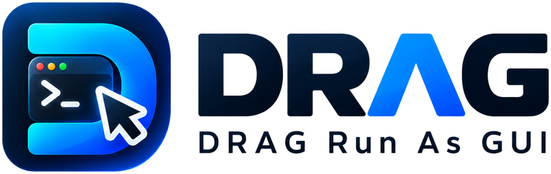
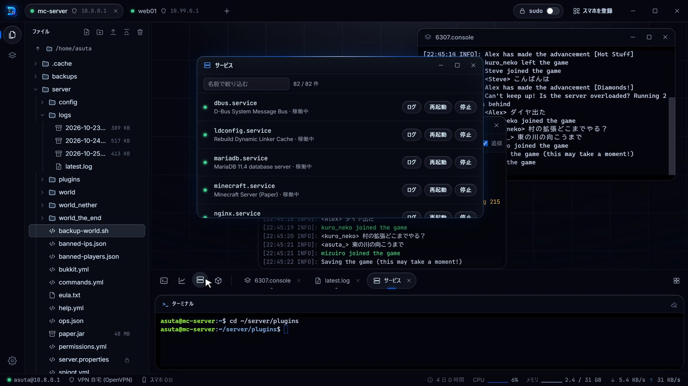

<p align="center">
  <picture>
    <source media="(prefers-color-scheme: dark)" srcset="mock/img/logo-dark.png">
    
  </picture>
</p>

DRAG は、SSH でつないだサーバーをGUI操作する Windows のアプリです。
サーバーに何も入れずに使えます。
SSH でログインでき、SFTP が使えるサーバーならそのままつなげます。

試すときは、[インストール](#インストール)と[サーバーにつなぐ](#サーバーにつなぐ)を読めば始められます。



## 画面

左の欄はファイルツリーとセッションの一覧で、左端のボタンで切り替えます。
右上はデスクトップで、ウィンドウを並べる場所です。
デスクトップの下に並ぶボタンで、新しいターミナル、リソース監視、サービス、Docker のウィンドウを開きます。
開いているウィンドウも、ボタンの右に並びます。
右下は普段のコマンドを打つターミナルです。

上の帯には、サーバーごとのタブと sudo のボタンと「スマホを登録」のボタンが並びます。
1つのタブに1台のサーバーを出します。
一番下の欄には、つないでいるユーザーとホスト、通している VPN、サーバーの稼働日数、CPU、メモリ、ネットワークが出ます。

## 特徴

### ssh や screen で入ったセッションがウィンドウになる

普通のターミナルでは、ssh で別のサーバーに入ると抜けるまでほかの操作ができません。
screen や tmux のセッション、docker exec で入ったコンテナも同じです。
DRAG ではこうしたセッションがデスクトップのウィンドウに移り、ターミナルは新しいプロンプトに戻ります。
screen で動かしているマイクラのサーバーのコンソールを開いたまま、ほかの作業を続けられます。

自動でウィンドウに移すコマンドは、デフォルトで ssh、docker exec、docker attach、screen、tmux、mysql、psql です。
設定でコマンドを追加したり外したりできます。

### コマンドを覚えなくても、ドラッグと右クリックで操作できる

ドラッグすると、落とした先によって次のようになります。

| ドラッグするもの | 落とす先 | どうなるか |
|---|---|---|
| ツリーのフォルダ | ターミナル | そのフォルダへ cd する |
| ツリーのファイル | ターミナル | ファイルのパスを入力する |
| ツリーのファイル | デスクトップ | 種類に合ったウィンドウで開く。テキストは編集、ログは末尾を追いかけて表示、画像はプレビュー |
| ツリーのファイル | ツリーのフォルダ | そのフォルダへ移す |
| ターミナルで実行中のセッション | デスクトップ | ウィンドウに移す。ターミナルは新しいプロンプトに戻る |
| セッションの一覧の項目 | デスクトップ | そのセッションをウィンドウで開く |
| Docker のコンテナ | デスクトップ | コンテナのシェルを開く |
| PC のファイル | ツリー | 落とした先のフォルダへアップロードする |

ファイルを右クリックすると、エクスプローラーと同じメニューが出ます。
切り取りやコピー、名前の変更や削除のほか、パスのコピーとダウンロードもここから行います。
圧縮ファイルは、サーバーに展開せずに中身を見られます。

削除したものはゴミ箱に移ります。
間違えて消しても、ゴミ箱から元に戻せます。

### sudo のパスワードは1回入れるだけ

上の帯の sudo のボタンで sudo モードを ON にすると、パスワードを1回聞かれます。
ON の間はパスワードを入れ直さずに、ファイルの編集やサービスの操作を sudo の権限で行えます。
ON にするかは、ログインしたユーザーで読めない場所を開いたときや書けないファイルを保存したときにも聞かれます。

sudo モードの ON と OFF はサーバーごとに分かれています。
パスワードは PC のメモリにだけ置き、OFF にするか DRAG を終了すると消えます。

### 違う VPN の中にあるサーバーに同時につなげる

DRAG の VPN は、そのサーバーへの接続だけを通すようになっています。
VPN は DRAG の中で張り、Windows のネットワークの設定やほかのソフトの通信はそのままです。
接続の画面でサーバーごとに VPN を選べるので、会社の VPN の中のサーバーと家の VPN の中のサーバーをタブで並べて使えます。

対応している VPN は次のとおりです。

- WireGuard
- OpenVPN
- IKEv2
- SSTP
- AnyConnect 互換
- L2TP/IPsec
- Tailscale

保存した VPN は、鍵とパスワードごと Windows の DPAPI で暗号化して PC に置きます。

### screen のセッションやサービスを一覧で確認できる

左の欄の「セッション」には、screen と tmux のセッションと DRAG で開いているウィンドウが並びます。
セッションには最後に使った日時が出るので、放っておいたものも見つけられます。

サービスのウィンドウには systemd のサービスが並び、行ごとに動いているかどうかが出ます。
起動、停止、再起動、ログのボタンもそれぞれの行にあります。
Docker のウィンドウでは、コンテナとイメージとボリュームを一覧で扱えます。

### リソースの使用量がグラフでわかる

一番下の欄には、CPU とメモリの使用量がグラフで出ます。
CPU やメモリを押すとリソース監視のウィンドウが開き、どのプロセスがどれだけ使っているかが並びます。
ウィンドウの中でディスクに切り替えると大きいフォルダが、ネットワークに切り替えると接続している相手が見られます。
グラフの期間は、直近の 60 秒、24 時間、30 日から選べます。
24 時間と 30 日の履歴は、DRAG がつないでいた間の値です。

### PC で開いたシェルをスマホで続けられる

スマホのブラウザから、PC の DRAG を通して同じサーバーを操作できます。
PC で開いていたターミナルも、続きから打てます。
スマホは、PC に出した QR コードを読んで登録します。
登録した端末だけがつなげます。
家の LAN の中で使えるほか、ルーターでポートを転送すれば外からも使えます。

### AI エージェントからも使える

DRAG と一緒に入る dragctl.exe を MCP のサーバーとして登録すると、AI エージェントから DRAG を操作できます。
保存済みのサーバーにつなぎ、コマンドを実行したりファイルを読み書きしたりできます。
スマホの登録 URL も出せます。

Claude Code には次のように登録します。

```
claude mcp add --scope user drag -- "C:\Program Files\asutarisucu\DRAG\dragctl.exe" mcp
```

エージェントが登録 URL を求めたときは、PC の画面で許すまで待ちます。
細かい動きは [app/README.md](app/README.md#ai-エージェントから使う) にあります。

## 動く環境

- PC は Windows の 64 bit 版
- サーバーは、SSH でログインでき SFTP が使えるもの

リソース監視とサービスと Docker のウィンドウは、Linux のサーバーを対象にしています。
Linux 以外のサーバーでは、ターミナルとファイルツリーを使えます。

## インストール

[Releases](https://github.com/asutarisucu/DRAG/releases) から `DRAG-<バージョン>-amd64-installer.exe` を落として実行します。
DRAG.exe と dragctl.exe はデフォルトで `C:\Program Files\asutarisucu\DRAG` に入ります。
スタートメニューと Windows のデスクトップにはショートカットができます。
画面の表示に使う WebView2 が無い PC では、インストールのときに Microsoft から取ってきます。
アンインストールしても、設定フォルダの `%AppData%\DRAG` は残ります。

ソースからビルドする方法は [app/README.md](app/README.md) にあります。

## 使い方

### サーバーにつなぐ

1. 「サーバーに接続」を押します
2. 名前、ホスト、ポート、ユーザーを入れ、認証をパスワードか鍵ファイルから選びます
3. VPN の中のサーバーなら、VPN の欄で通す VPN を選びます。新しい VPN は「新しい VPN を追加…」から追加します
4. 「接続」を押します
5. 初めてつなぐサーバーでは、サーバーの鍵の指紋が出ます。サーバーの管理者に聞いたものと同じなら「信頼して接続」を押します。違っていたら接続せずに、管理者に確認してください
6. 「開く」を押します

つないだサーバーは「保存済み」に残ります。
パスワードは保存されないようになっています。
つなぐときに毎回入れます。
2台目からは、上の帯でタブの右にある + から追加します。

ツリーのファイルをデスクトップへドラッグしたり、左の欄の「セッション」から screen のセッションを開いたりしてみてください。
ほかの操作は[特徴](#特徴)に書いてあります。

### スマホから使う

1. 左下の設定を開き、「スマホ」で「LAN 内で待ち受ける」を ON にします
2. 上の帯の「スマホを登録」を押すと、QR コードが出ます
3. スマホのカメラで QR コードを読みます
4. 初めて開くときは、ブラウザに証明書の警告が出ます。証明書の詳細を開き、SHA-256 の指紋が PC の画面に出ているものと同じなら進みます。違っていたら進まないでください

QR コードは5分たつか、1回使うと無効になります。
登録した端末とログインの履歴は、「スマホを登録」の画面で見られます。
スマホをなくしたときは、そこで端末を無効にします。

### 外からスマホで使う

設定の「スマホ」で「インターネットに公開する」を ON にします。
設定の「公開するポート」で決めたポートを、ルーターでこの PC へ転送しておきます。
IP アドレスの証明書は、DRAG が Let's Encrypt で取って数日おきに自動で更新します。

LAN の中と外からでは URL が違います。
「スマホを登録」の画面では、LAN 内と外からを切り替えられます。
スマホはそれぞれの QR コードで登録します。
グローバル IP が変わると URL も変わるので、そのときは QR コードを読み直します。

PC がスリープしている間は、スマホからつながりません。
外から使うときは、電源の設定でスリープしないようにしておきます。

### DRAG を終了する

画面を閉じても、DRAG は通知領域に残ります。
サーバーとの接続とスマホの待ち受けはそのまま続きます。
終了は、通知領域のアイコンのメニューから行います。

## ライセンス

[MIT](LICENSE)
