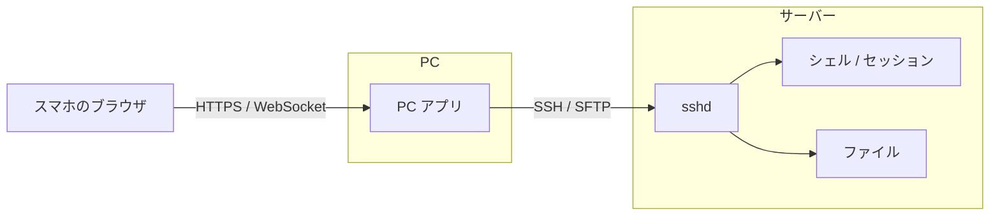

# DRAG 企画書

DRAG(DRAG Runs As GUI)は、SSH 先のサーバーで複数のセッションをウィンドウに分けて同時に操作できるターミナルソフトです。
サーバーには何も入れず、PC アプリが SSH と SFTP だけでサーバーとやり取りします。
スマホからは、PC アプリを踏み台にして同じサーバーを操作します。
この企画書は、ヒアリングで決まったことと、まだ決まっていないことをまとめたものです。

更新: 2026-10-24(サーバーにエージェントを置く構成をやめ、スマホは PC アプリを踏み台にする構成にした)

## 1. SSH 先のサーバーで、複数のセッションをウィンドウに分けて同時に操作する

DRAG は SSH で接続したサーバーを操作するためのソフトです。
ターミナルでは、screen や tmux のセッションに入ったり、ssh でさらに別のサーバーに入ったり、docker exec でコンテナに入ったりすると、抜けるまでほかの操作ができません。
DRAG はこうしたセッションをウィンドウに分けてデスクトップに並べ、同時に操作できるようにします。
サーバーのファイルは左にツリーで出します。

コンセプトは直感的な操作と GUI です。
名前の DRAG はマウスのドラッグから取りました。
ファイルやセッションをドラッグして開く、渡す、という操作を中心に置きます。

利用の流れは次のとおりです。

1. PC アプリをインストールする
2. PC アプリからサーバーに SSH で接続する
3. スマホを PC アプリに登録すると、スマホのブラウザから PC アプリを通して同じサーバーを操作できる

サーバーには DRAG のプログラムを入れません。
SSH でログインでき、SFTP が使えるサーバーなら DRAG でつなげます。
PC アプリとスマホのブラウザは同じ画面を使います。

## 2. 画面は左のファイルツリー、右上のデスクトップ、右下のターミナルの3区画

```
+----------------------------------------------------------+
| [ mc-server ] [ db01 ] [ + ]                             |
+----------------+-----------------------------------------+
| Explorer       | Desktop                                 |
|                |   +--------------+  +--------------+    |
| /home/user     |   | screen: mc   |  | ssh: db01    |    |
|  - server/     |   |              |  |              |    |
|  - logs/       |   +--------------+  +--------------+    |
|  - .bashrc     |                                         |
|                +-----------------------------------------+
|                | Terminal                                |
|                | $ _                                     |
+----------------+-----------------------------------------+
```

左はサーバーのディレクトリを、VS Code のエクスプローラーのようにツリーで出す区画です。
VS Code と同じく表示を切り替えられるようにし、ファイルツリーのほかに screen と tmux のセッションの一覧を置く案です。

右上のデスクトップは、Windows のデスクトップのように作業をウィンドウにして並べる区画です。
ウィンドウは移動、大きさの変更、最小化ができます。
例えば複数の screen のセッションと、ssh で入った別のサーバーを横に並べて操作できます。

右下は普段のコマンド入力に使うターミナルです。
VS Code の下にあるターミナルと同じ位置づけです。
ここでセッションに入ると、そのセッションはデスクトップのウィンドウに移り、ターミナルは新しいプロンプトに戻ります。
移し方は2つあります。

- 自動: ssh や docker exec など、登録したコマンドが前面で動き始めたら自動でウィンドウに移す
- ドラッグ: 実行中のセッションを、ターミナルからデスクトップへドラッグして移す

前面で動いているコマンドは、PC アプリが SSH の別のチャネルでサーバーの `/proc` を読んで調べます。
tmux がウィンドウ名を自動で付けるときと同じ情報を使います。
tmux は疑似端末の前面のプロセスを `tcgetpgrp` で取り、`/proc/<pid>/cmdline` からコマンド名を読みます(tmux@master `osdep-linux.c` の `osdep_get_name`)。
DRAG はシェルの `/proc/<pid>/stat` から前面のプロセスグループの番号を読み、そのプロセスの `cmdline` を読む案です(7章で検証)。
新しいプロンプトは、元のシェルと同じディレクトリで開きます。
自動で移すコマンドの一覧は、設定で足し引きできます。

上のタブはサーバーごとに分けます。
1つのタブに出すのは1台のサーバーです。

ドラッグでの操作は次を案にしています。
細かい動きは HTML のモックで詰めます。

| ドラッグするもの | 落とす先 | 起きること |
|---|---|---|
| ターミナルで実行中のセッション | デスクトップ | セッションをウィンドウに移す。ターミナルは新しいプロンプトに戻る |
| セッションの一覧の項目 | デスクトップ | そのセッションをウィンドウで開く |
| ツリーのファイル | ターミナル | ファイルのパスを入力する |
| ツリーのファイル | デスクトップ | 種類に合ったウィンドウで開く。テキストは編集、ログは追従表示、画像はプレビュー |
| ツリーのフォルダ | ターミナル | そのフォルダへ cd する |
| PC のファイル | ツリー | そのフォルダへアップロードする |
| ツリーのファイル | PC のフォルダ | ダウンロードする(PC アプリのみ) |

スマホでは3区画を横に並べる幅がありません。
区画をタブで切り替え、デスクトップのウィンドウは1つずつ全画面で出す形を暫定案にします。
ドラッグは長押しのメニューで代えます。
ターミナルには、スマホのキーボードにない Ctrl・Esc・Tab・矢印のキーを並べた列を足します。

## 3. 既存のソフトにない部分は、デスクトップ区画とスマホからの続き操作

近い形のソフトはいくつかあります。
MobaXterm は左に SFTP のファイル一覧、右にターミナルを並べます。DRAG の左と右下はこの配置に近いです。
VS Code の Remote-SSH は、接続したときにサーバー側へ VS Code Server を入れて起動します。
Cockpit はサーバーに入れておき、ブラウザからサービスやログ、ターミナルを操作するソフトです。

DRAG がこれらと違うのは2点です。
1つ目は、セッションやログなど複数の作業をウィンドウで同時に並べるデスクトップ区画です。
2つ目は、PC で開いていたターミナルを、スマホのブラウザからそのまま続きで操作できることです。
サーバーに何も入れない点は MobaXterm と同じで、VS Code の Remote-SSH や Cockpit とは違います。

## 4. PC アプリがサーバーとのやり取りを持ち、スマホは PC アプリにつなぐ

ブラウザは SSH を直接話せません。
スマホのブラウザからサーバーを操作するには、ブラウザからの接続を受けて SSH につなぐプログラムが要ります。
DRAG では PC アプリがこれを兼ね、スマホは PC アプリを踏み台にしてサーバーに入ります。



PC アプリが持つものは次のとおりです。

- サーバーとの SSH の接続と、その上で動くシェル。スマホがつなぎ直したときのために、直近の出力も持つ
- 前面で動いているコマンドの監視。自動の切り出しに使う
- ファイルの一覧、読み書き、アップロード(SFTP)
- CPU・メモリ・ディスク・ネットワークの使用量と、systemd のサービスの状態の取得。SSH でコマンドを実行して読む
- 設定、ウィンドウ配置、リソースの履歴、操作の記録
- スマホからの接続の受付と認証
- 画面(Web UI)のスマホへの配信

スマホの画面も PC アプリを通るので、サーバーとやり取りする処理は PC アプリの1か所に書けば済みます。
設定とウィンドウ配置は端末ごとに持ち、PC とスマホで共有しません。
DRAG の設定や記録はサーバーに置きません。

この構成では、シェルは PC アプリとサーバーの間の SSH の接続の上で動きます。
PC アプリが終わるか、PC とサーバーの間の回線が切れると、シェルも終わります。
screen や tmux の中で動かしているものは残ります。
スマホから入れるのは、PC が起動していて、PC アプリが動いている間です。
別の PC の DRAG からは、その PC で開いたシェルは見えません。

### 接続したときは、サーバーで使える機能を調べる

PC アプリはサーバーに接続するたびに、SSH でコマンドを実行して OS と、systemd・docker・screen・tmux の有無を調べます(案)。
結果に合わせて、出すウィンドウとセッションの一覧を決めます。
systemd がなければサービスのウィンドウを、docker がなければ Docker のウィンドウを出しません。
`/proc` がない Linux 以外の機器(ルーターなど)では、ターミナルとファイルツリーだけを使います。

### sudo モードでは、PC アプリがパスワードを持って sudo に渡す

sudo モードを ON にすると、PC アプリは入力されたパスワードを PC のメモリに持ちます。
ON の間の GUI の操作は、コマンドを `sudo` 付きで実行し、パスワードを sudo に渡して行う案です。
ファイルの操作は、sudo の権限で起動した sftp-server と SFTP で話す案です(7章で検証)。
OFF にするか、PC アプリを閉じたら、パスワードを消します。

## 5. スマホは LAN 内から PC アプリにつなぎ、認証は QR コードでの端末登録にする

スマホから開いたシェルは、SSH でログインしたユーザーの権限をそのまま持ちます。
認証を破られると、SSH のパスワードを盗まれたのと同じことになります。

PC アプリは LAN に向けて HTTPS で待ち受けます。
証明書は PC アプリが作る自己署名のものです。
スマホで最初に開くときに、ブラウザの警告を受け入れる操作が要ります。
外からつなぐ経路は10章の未決事項です。
トンネルサービスと DRAG の中継サーバーは作りません(8章)。

認証は、PC アプリに出した QR コードでスマホを登録する形にします。
PC アプリが使い捨てのペアリング用トークンを作り、待ち受けの URL と一緒に QR コードにして表示します。
スマホで読むと、その端末用の資格情報が発行されます。
登録した端末の一覧は PC アプリから見られるようにし、スマホをなくしたときは端末ごとに無効にできるようにします。

次も入れます。

- ログイン画面にパスワードの入力欄を置かない。登録済みの端末だけが入れる
- ペアリング用のトークンは、1回使うか数分たつと無効にする
- ログインと端末の登録の履歴を PC アプリに出す
- WebSocket の接続元(Origin)を確かめる

## 6. 技術スタックは Go と TypeScript の2言語に絞る案

| 部分 | 案 | 理由 |
|---|---|---|
| PC アプリ | Wails(Go) | SSH と SFTP のライブラリ(golang.org/x/crypto/ssh、pkg/sftp)がある。スマホ向けの HTTPS の待ち受けも同じ Go の側で持てる |
| 画面 | TypeScript + React + Tailwind CSS + xterm.js | xterm.js は VS Code のターミナルでも使われている |

PC アプリの枠組みは3つを比べました。

| | Wails | Tauri | Electron |
|---|---|---|---|
| 書く言語 | Go | Rust | TypeScript |
| Windows での表示 | WebView2 | WebView2 | 同梱の Chromium |
| 配布物の大きさ | 小さい | 小さい | Chromium を含むぶん大きい |
| SSH の実装 | golang.org/x/crypto/ssh | russh など | ssh2 |

Electron は Tabby や Hyper などのターミナルソフトで使われていて、使用例は一番多いです。
PC アプリの重い処理は SSH の通信と画面の描画で、通信は回線の速さ、描画は WebView の速さで決まります。
技術検証で足りない速さが見つかったときに、Tauri を試します (見立て)。
Wails は v2 が安定版で、v3 は 2026-10 の時点でベータです。
画面は TypeScript + React + Tailwind CSS で作ります。
文言は i18n の仕組みで持ち、日本語をデフォルトにして英語にも対応します。

## 7. 技術検証で確かめること

結果は `docs/verification.md` に残します。

| 検証 | 状態 |
|---|---|
| Wails の WebView2 の上で、xterm.js に日本語入力が通るか | Meltype では通る。Microsoft IME と Google 日本語入力は未確認 |
| PC の幅のターミナルを、スマホで横スクロールさせて表示できるか | できる。実機は未確認 |
| 前面で動いているコマンドを、SSH の別のチャネルから調べて切り出せるか | 未 |
| sudo モードで、ファイルの操作とコマンドを sudo の権限で行えるか | 未 |
| PC アプリから LAN に HTTPS で待ち受け、スマホからつなげるか | 未 |

エージェントを置く構成のために挙げていた3つ(エージェントを入れ替えてもシェルが残るか、エージェントの転送にかかる時間、IP アドレスの証明書)は、構成を変えたので取りやめました。

## 8. 対象外

- リモートのデスクトップ画面を映す機能(RDP や VNC のようなもの)
- サーバーに DRAG のプログラムやサービスを入れること
- トンネルサービスと DRAG の中継サーバーを使った接続
- Windows と macOS のサーバーでのリソース監視とサービスの操作。Linux を先にします
- 複数人での同時利用と、利用者ごとの権限管理
- Telnet やシリアルでの接続

## 9. 決まったこと

| 論点 | 決定 | 日付 |
|---|---|---|
| サーバー側のプログラム | 入れない。PC アプリが SSH と SFTP でサーバーとやり取りする。サーバーにエージェントを置く案は取りやめた | 2026-10-24 |
| スマホからの経路 | PC アプリを踏み台にしてサーバーに入る | 2026-10-24 |
| デスクトップに並べるもの | screen と tmux のセッション、DRAG のターミナル。screen に限らず、入ると抜けるまでほかの操作ができないセッション全般を並べて操作できるようにする | 2026-10-24 |
| 配布の範囲 | GitHub で一般公開 | 2026-10-24 |
| 実行中のセッションをウィンドウに移す方法 | 自動で移すのと、ドラッグで移すの2つ | 2026-10-24 |
| LAN 内での通信 | 自己署名の証明書で HTTPS | 2026-10-24 |
| 複数のサーバー | サーバーごとにタブで切り替える | 2026-10-24 |
| 最初の版のウィンドウ | セッション、ファイルの編集、ログの追従表示、リソース監視、サービス操作、Docker | 2026-10-24 |
| PC からのアップロード | ファイルツリーへのドラッグ&ドロップ。フォルダの行に落とすとそのフォルダ、ファイルの行に落とすとそのファイルのあるフォルダへ入れる | 2026-10-24 |
| リソース監視 | 項目をクリックすると詳細を出す。CPU とメモリはプロセスごとの使用量、ディスクは大きいフォルダ、ネットワークは接続中の相手 | 2026-10-24 |
| 下のタブ | ドラッグで並べ替えられる。タブの右の × で閉じられる | 2026-10-24 |
| Docker | コンテナ・イメージ・ボリュームを GUI で扱う。コンテナは起動・停止・再起動・削除、シェルとログを開く操作を置く | 2026-10-24 |
| 一番下の欄 | 稼働日数、CPU とメモリの数値とグラフ、ネットワークの下りと上りを出す | 2026-10-24 |
| 圧縮ファイル | ファイルのメニューに「解凍して閲覧」を置く。中身はサーバーに書き出さない | 2026-10-24 |
| 設定 | 左の欄の一番下に置き、色と操作を変えられるようにする | 2026-10-24 |
| 画面 | `mock/` のモックに沿って作る | 2026-10-24 |
| PC アプリの対象 OS | Windows を先にする | 2026-10-24 |
| 対象のサーバー | SSH と SFTP でつなげるサーバー。リソース監視とサービスの操作は Linux(systemd)を対象にする | 2026-10-24 |
| スマホの認証 | PC アプリに出した QR コードで端末を登録する | 2026-10-24 |
| 自動でウィンドウに移すコマンドの初期の一覧 | ssh、docker exec、docker attach、screen、tmux、mysql、psql。設定で足し引きできる | 2026-10-24 |
| sudo モード | トグルボタンで切り替える。ON にするときにパスワードを求める。ON の間は、ファイルの移動や編集、サービスの操作といった GUI の操作を sudo の権限で行う | 2026-10-24 |
| サービスの操作 | sudo モードで実行する。sudo モードが OFF のときは ON にするよう求める | 2026-10-24 |
| サービスのログ | サービスの行にも「ログ」のボタンを置く | 2026-10-24 |
| ホームの外と root のファイル | sudo モードのときだけ開いて変更できる | 2026-10-24 |
| ファイル操作 | Windows のエクスプローラーのように、右クリックで削除・コピー・切り取り・貼り付け・名前の変更・パスのコピーなどができるようにする。削除はゴミ箱へ移す | 2026-10-24 |
| ライセンス | MIT | 2026-10-24 |
| Windows のコード署名 | いったん署名しない | 2026-10-24 |
| スマホでの稼働日数・CPU などの表示 | スマホでは出さない | 2026-10-24 |
| 設定とウィンドウ配置の保存先 | どちらも端末ごとに持ち、PC とスマホで共有しない | 2026-10-24 |
| 画面の言語 | デフォルトは日本語で、英語にも対応する。文言は i18n の仕組みで持ち、あとから言語を足せるようにする。設定から変えられる | 2026-10-24 |
| 画面のフレームワーク | TypeScript + React + Tailwind CSS | 2026-10-24 |
| 作る順番 | 11章のとおり | 2026-10-24 |
| 大きいファイルを開くとき | 末尾から読み、上へスクロールしたら前を読み足す | 2026-10-24 |
| 通知 | 行わない | 2026-10-24 |
| 操作の記録 | スマホから実行したコマンドやサービスの操作を記録し、ログインの履歴と同じ場所で見られるようにする | 2026-10-24 |
| 放置されたセッション | 自動では閉じない。セッションの一覧に最後に使った日時を出す | 2026-10-24 |
| モックになかった画面 | 作る。スマホで QR を読んだ後の画面 (登録・期限切れ・登録していない端末)、接続が切れたときの表示、サーバーが1台もないときの最初の画面 | 2026-10-24 |
| PC アプリの枠組み | Go で書ける Wails を使ってみる。Rust の速さが活きる場面があれば Tauri も考える | 2026-10-24 |
| sudo モードを持つ単位 | 端末ごと・サーバーごと・セッションごとに持つ。アプリを閉じたら OFF になる | 2026-10-24 |
| sudo モードの自動 OFF | 操作がないときに勝手に OFF にはしない | 2026-10-24 |
| 同じターミナルを PC とスマホで同時に開いたときの幅 | 幅はそろえない。1つのシェルは幅を1つしか持てないので、PC で開いているターミナルをスマホで開いたときは PC の幅のまま表示し、はみ出す分は横にスクロールする。スマホだけで開いたときはスマホの幅にする | 2026-10-24 |
| Wails の版 | 安定版の v2 で始める | 2026-10-24 |

## 10. 未決事項

| 論点 | 暫定案 |
|---|---|
| PC アプリの窓を閉じたとき | 通知領域に残し、SSH の接続とスマホの待ち受けを続ける。終了は通知領域のメニューから行う |
| PC アプリが終わったときのシェル | 一緒に終わる。残したいものは screen や tmux の中で動かす |
| 外からスマホでつなぐ経路 | LAN 内だけにする。外からは、利用者が用意した VPN(Tailscale など)で LAN と同じようにつなぐ |
| リソースの履歴 | PC アプリが接続している間だけ PC に記録する。接続していない間は空く |

## 11. 進め方

1. ヒアリングで未決事項を決める
2. HTML のモックを、サーバーに何も入れない構成に合わせて直す。接続の流れ、スマホの登録、SSH だけのモードの表示が変わる
3. 7章の技術検証を行う
4. 最初の版を次の順で作る
   1. PC アプリで、ターミナルとファイルツリー
   2. デスクトップと自動の切り出し
   3. スマホ (LAN と QR での登録)
   4. リソース監視・サービス・Docker
