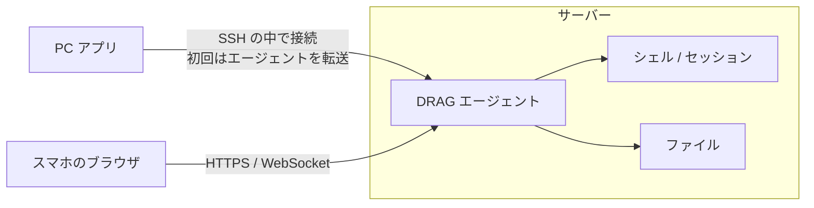

# DRAG 企画書

DRAG(DRAG Runs As GUI)は、SSH 先のサーバーで複数のセッションをウィンドウに分けて同時に操作できるターミナルソフトです。
PC アプリで接続したときにサーバーへエージェントを入れ、その後はスマホのブラウザからも同じ画面で操作できるようにします。
この企画書は、ヒアリングで決まったことと、まだ決まっていないことをまとめたものです。

更新: 2026-10-24(未決事項がなくなった)

## 1. SSH 先のサーバーで、複数のセッションをウィンドウに分けて同時に操作する

DRAG は SSH で接続したサーバーを操作するためのソフトです。
ターミナルでは、screen や tmux のセッションに入ったり、ssh でさらに別のサーバーに入ったり、docker exec でコンテナに入ったりすると、抜けるまでほかの操作ができません。
DRAG はこうしたセッションをウィンドウに分けてデスクトップに並べ、同時に操作できるようにします。
サーバーのファイルは左にツリーで出します。

コンセプトは直感的な操作と GUI です。
名前の DRAG はマウスのドラッグから取りました。
ファイルやセッションをドラッグして開く、渡す、という操作を中心に置きます。

利用の流れは次のとおりです。

1. PC アプリをインストールする
2. PC アプリからサーバーに SSH で接続する
3. 初回の接続で、サーバー側のセットアップ(エージェントの配置と登録)を自動で行う
4. 以後はスマホなどのブラウザからもサーバーにアクセスできる

PC アプリとブラウザ版は同じ画面を使います。
PC アプリは、サーバーにエージェントを入れる道具と、ブラウザ版と同じ画面を開く窓を兼ねます。
エージェントを入れられないサーバーには、SSH だけで動くモードでつなぎます(4章)。

## 2. 画面は左のファイルツリー、右上のデスクトップ、右下のターミナルの3区画

```
+----------------------------------------------------------+
| [ mc-server ] [ db01 ] [ + ]                             |
+----------------+-----------------------------------------+
| Explorer       | Desktop                                 |
|                |   +--------------+  +--------------+    |
| /home/user     |   | screen: mc   |  | ssh: db01    |    |
|  - server/     |   |              |  |              |    |
|  - logs/       |   +--------------+  +--------------+    |
|  - .bashrc     |                                         |
|                +-----------------------------------------+
|                | Terminal                                |
|                | $ _                                     |
+----------------+-----------------------------------------+
```

左はサーバーのディレクトリを、VS Code のエクスプローラーのようにツリーで出す区画です。
VS Code と同じく表示を切り替えられるようにし、ファイルツリーのほかに screen と tmux のセッションの一覧を置く案です。

右上のデスクトップは、Windows のデスクトップのように作業をウィンドウにして並べる区画です。
ウィンドウは移動、大きさの変更、最小化ができます。
例えば複数の screen のセッションと、ssh で入った別のサーバーを横に並べて操作できます。

右下は普段のコマンド入力に使うターミナルです。
VS Code の下にあるターミナルと同じ位置づけです。
ここでセッションに入ると、そのセッションはデスクトップのウィンドウに移り、ターミナルは新しいプロンプトに戻ります。
移し方は2つあります。

- 自動: ssh や docker exec など、登録したコマンドが前面で動き始めたら自動でウィンドウに移す
- ドラッグ: 実行中のセッションを、ターミナルからデスクトップへドラッグして移す

前面で動いているコマンドは、エージェントが疑似端末から調べます。
tmux がウィンドウ名を自動で付けるのと同じ方法で、`tcgetpgrp` で前面のプロセスを取り、`/proc/<pid>/cmdline` からコマンド名を読みます(tmux@master `osdep-linux.c` の `osdep_get_name`)。
新しいプロンプトは、元のシェルと同じディレクトリで開きます。
自動で移すコマンドの一覧は、設定で足し引きできます。

上のタブはサーバーごとに分けます。
1つのタブに出すのは1台のサーバーです。

ドラッグでの操作は次を案にしています。
細かい動きは HTML のモックで詰めます。

| ドラッグするもの | 落とす先 | 起きること |
|---|---|---|
| ターミナルで実行中のセッション | デスクトップ | セッションをウィンドウに移す。ターミナルは新しいプロンプトに戻る |
| セッションの一覧の項目 | デスクトップ | そのセッションをウィンドウで開く |
| ツリーのファイル | ターミナル | ファイルのパスを入力する |
| ツリーのファイル | デスクトップ | 種類に合ったウィンドウで開く。テキストは編集、ログは追従表示、画像はプレビュー |
| ツリーのフォルダ | ターミナル | そのフォルダへ cd する |
| PC のファイル | ツリー | そのフォルダへアップロードする |
| ツリーのファイル | PC のフォルダ | ダウンロードする(PC アプリのみ) |

スマホでは3区画を横に並べる幅がありません。
区画をタブで切り替え、デスクトップのウィンドウは1つずつ全画面で出す形を暫定案にします。
ドラッグは長押しのメニューで代えます。
ターミナルには、スマホのキーボードにない Ctrl・Esc・Tab・矢印のキーを並べた列を足します。

## 3. 既存のソフトにない部分は、デスクトップ区画とスマホからの続き操作

近い形のソフトはいくつかあります。
MobaXterm は左に SFTP のファイル一覧、右にターミナルを並べます。DRAG の左と右下はこの配置に近いです。
VS Code の Remote-SSH は、接続したときにサーバー側へ VS Code Server を入れて起動します。DRAG の、接続時にセットアップする流れはこれと同じ形です。
Cockpit はサーバーに入れておき、ブラウザからサービスやログ、ターミナルを操作するソフトです。

DRAG がこれらと違うのは2点です。
1つ目は、セッションやログなど複数の作業をウィンドウで同時に並べるデスクトップ区画です。
2つ目は、PC で開いていたウィンドウとターミナルを、スマホのブラウザからそのまま続きで操作できることです。
2つ目は、4章の構成を採った場合に成り立ちます。

## 4. サーバー側のエージェントを中心に置き、PC アプリもブラウザもそこにつなぐ

ブラウザは SSH を直接話せません。
スマホのブラウザからサーバーを操作するには、サーバー側でブラウザからの接続を受けてシェルにつなぐプログラムが要ります。
これを DRAG エージェントと呼びます。

提案は、PC アプリもこのエージェント経由で動かすことです。
PC アプリは SSH の接続の中でエージェントにつなぎ、ブラウザは HTTPS でエージェントにつなぎます。
画面はどちらも同じものを使います。



エージェントが持つものは次のとおりです。

- シェルとセッションを動かす疑似端末(PTY)。PC やスマホとの接続が切れても動き続け、再接続したら続きを表示する
- 前面で動いているコマンドの監視。自動の切り出しに使う
- ファイルの一覧、読み書き、アップロード
- CPU・メモリ・ディスク・ネットワークの使用量と、systemd のサービスの状態の取得
- デスクトップのウィンドウ配置
- ブラウザからの接続の認証
- 画面(Web UI)の配信

この構成にすると、PC で開いたセッションのウィンドウを、外出先でスマホから開いても同じ配置で出せます。
サーバーとやり取りする処理はエージェントに1つ書けば済み、PC 用とブラウザ用で2回書かずに済みます。
PC アプリは SSH の中でつなぐので、サーバーに外向きのポートを開けなくても PC からは使えます。

エージェントを入れられないサーバーには、SSH だけで動くモードでつなぎます。
書き込み権限がないサーバーや、ルーターのような機器がこれにあたります。
このモードでは PC アプリが SSH と SFTP で直接サーバーとやり取りし、使える機能が減ります。

| 機能 | エージェントあり | SSH だけのモード |
|---|---|---|
| ファイルツリー | 使える | 使える(SFTP) |
| ターミナルとデスクトップのウィンドウ | 使える | 使える |
| セッションの切り出し | 自動とドラッグ | ドラッグだけ(暫定) |
| PC アプリを閉じた後の DRAG のターミナル | 動き続ける | 終了する |
| スマホからの操作 | できる | できない |
| ウィンドウ配置の保存先 | サーバー。PC とスマホで共有 | PC |

## 5. 初回接続時のセットアップで、エージェントの配置と登録までを済ませる

PC アプリはサーバーに接続するたびに、エージェントの有無と版を確かめます。
無いか古ければ、次の手順で入れます。

1. `uname` で OS と CPU を調べ、合う実行ファイルを選ぶ
2. SFTP でホームディレクトリの下(例: `~/.drag/`)に置く
3. サーバーが再起動しても動くように、サービスとして登録する
4. スマホ用のペアリングの QR コードを PC アプリに出す

エージェントは、SSH でログインしたユーザーの権限で動かします。
ブラウザから開いたシェルも、そのユーザーができることしかできない形になります。

サービスの登録には sudo が要る場合があります。
暫定では、sudo を1回だけ使い、そのユーザーで動く systemd のサービスとして登録します。
sudo できないサーバーでは、PC アプリが接続している間だけエージェントを動かします。

アンインストールは、PC アプリからサービスの登録を外して `~/.drag/` を消す操作として用意します。

## 6. スマホからは LAN 内と直接公開の2経路でつなぎ、認証は QR コードでの端末登録にする

ブラウザから開いたシェルは、そのユーザーの権限をそのまま持ちます。
直接公開ではインターネットのどこからでもログイン画面に届きます。
認証を破られると、SSH のパスワードを盗まれたのと同じことになります。

経路は LAN 内と、ポートの直接公開の2つに対応します。
利用者が自分で VPN(Tailscale など)を用意した場合は、LAN と同じ待ち受けで使えます。
トンネルサービスと DRAG の中継サーバーは作りません(8章)。

### 証明書

直接公開では HTTPS の証明書が要ります。
候補は次の3つです。

| 方法 | 利用者が用意するもの | 待ち受けに要るポート | 注意点 |
|---|---|---|---|
| 自分のドメイン + Let's Encrypt | ドメインと DNS の設定 | 80 か 443 | DNS-01 で取るならポートは要らないが、DNS サービスの API キーをエージェントに渡すことになる |
| IP アドレスの証明書(Let's Encrypt) | なし | 80 か 443 | 有効期間が160時間なので、エージェントが数日おきに自動で更新する |
| 利用者のリバースプロキシ(nginx など)の後ろに置く | プロキシと証明書の設定 | プロキシ側で用意する | エージェントは localhost だけで待ち受ける |

Let's Encrypt は 2026-01-15 から IP アドレスの証明書を一般提供しています。
ドメインを持っていない人でも、サーバーのグローバル IP に対して証明書を取れます。
取るときの確認は HTTP-01 か TLS-ALPN-01 で、それぞれ 80 番と 443 番のポートを使います。
1024 番より下のポートで待ち受けるには権限が要ります。
sudo でサービスを登録するときに、この権限だけをエージェントに与えます。

暫定では、ドメインがあればドメインの証明書を、なければ IP アドレスの証明書を Let's Encrypt で取ります。

LAN 内では、自己署名の証明書で HTTPS にします。
スマホで最初に開くときに、ブラウザの警告を受け入れる操作が要ります。

### 認証

認証は、PC アプリに出した QR コードでスマホを登録する形を暫定案にします。
PC アプリは SSH で認証済みなので、エージェントに使い捨てのペアリング用トークンを出させ、QR コードにして表示します。
スマホで読むと、その端末用の資格情報が発行されます。
登録した端末の一覧は PC アプリから見られるようにし、スマホをなくしたときは端末ごとに無効にできるようにします。

直接公開に向けて、次も入れます。

- ログイン画面にパスワードの入力欄を置かない。登録済みの端末だけが入れる
- ペアリング用のトークンは、1回使うか数分たつと無効にする
- ログインと端末の登録の履歴を PC アプリに出す
- WebSocket の接続元(Origin)を確かめる

## 7. 技術スタックは Go と TypeScript の2言語に絞る案

| 部分 | 案 | 理由 |
|---|---|---|
| エージェント | Go | 1つの実行ファイルにまとまり、amd64 と arm64 向けにクロスコンパイルできる。サーバーに実行環境を入れずに置くだけで動く |
| 画面 | TypeScript + React + Tailwind CSS + xterm.js | xterm.js は VS Code のターミナルでも使われている |
| PC アプリ | Wails | Go で書けるので、SSH の接続やエージェントとの通信のコードをエージェントと共有できる |

PC アプリの枠組みは3つを比べました。

| | Wails | Tauri | Electron |
|---|---|---|---|
| 書く言語 | Go | Rust | TypeScript |
| Windows での表示 | WebView2 | WebView2 | 同梱の Chromium |
| 配布物の大きさ | 小さい | 小さい | Chromium を含むぶん大きい |
| SSH の実装 | golang.org/x/crypto/ssh | russh など | ssh2 |
| エージェントと同じ言語で書けるか | 書ける | 書けない | 書けない |

Electron は Tabby や Hyper などのターミナルソフトで使われていて、使用例は一番多いです。
DRAG の PC アプリの仕事は、SSH の接続、エージェントの転送、画面の表示、SSH だけのモードの4つです。
SSH だけのモードでは、PC アプリの Go の側がエージェントと同じ API を SSH と SFTP で実装します。
画面からは、つなぎ先がエージェントか PC アプリかを区別せずに済みます。
API の定義と通信の処理をエージェントと共有できる Wails を使います。
PC アプリの重い処理は SSH の通信と画面の描画で、通信は回線の速さ、描画は WebView の速さで決まります。
Rust の速さが効くのは PC の側で大きなデータを処理する場合ですが、今の設計ではそうした処理はエージェントが持ちます。
技術検証で足りない速さが見つかったときに、Tauri を試します (見立て)。
Wails は v2 が安定版で、v3 は 2026-10 の時点でベータです。
画面は TypeScript + React + Tailwind CSS で作ります。
文言は i18n の仕組みで持ち、日本語をデフォルトにして英語にも対応します。

技術検証で確かめることは次の5つです。

- Wails の WebView2 の上で、xterm.js に日本語入力が通るか
- エージェントの転送から起動までにかかる時間
- PC の幅のターミナルを、スマホで横スクロールさせて表示できるか
- エージェントを入れ替えても、シェルが切れずに残るか
- IP アドレスの証明書を、エージェントから取得して更新し続けられるか

## 8. 対象外

- リモートのデスクトップ画面を映す機能(RDP や VNC のようなもの)
- トンネルサービスと DRAG の中継サーバーを使った接続
- Windows と macOS のサーバーへのエージェントの導入。Linux を先にします
- 複数人での同時利用と、利用者ごとの権限管理
- Telnet やシリアルでの接続

## 9. 決まったこと

| 論点 | 決定 | 日付 |
|---|---|---|
| デスクトップに並べるもの | screen と tmux のセッション、DRAG のターミナル。screen に限らず、入ると抜けるまでほかの操作ができないセッション全般を並べて操作できるようにする | 2026-10-24 |
| スマホからの経路 | LAN 内と、ポートの直接公開 | 2026-10-24 |
| エージェントを入れられないサーバー | SSH だけのモードを作る | 2026-10-24 |
| 配布の範囲 | GitHub で一般公開 | 2026-10-24 |
| 実行中のセッションをウィンドウに移す方法 | 自動で移すのと、ドラッグで移すの2つ | 2026-10-24 |
| LAN 内での通信 | 自己署名の証明書で HTTPS | 2026-10-24 |
| 複数のサーバー | サーバーごとにタブで切り替える。スマホはサーバーごとの URL を開く | 2026-10-24 |
| 最初の版のウィンドウ | セッション、ファイルの編集、ログの追従表示、リソース監視、サービス操作、Docker | 2026-10-24 |
| PC からのアップロード | ファイルツリーへのドラッグ&ドロップ。フォルダの行に落とすとそのフォルダ、ファイルの行に落とすとそのファイルのあるフォルダへ入れる | 2026-10-24 |
| リソース監視 | 項目をクリックすると詳細を出す。CPU とメモリはプロセスごとの使用量、ディスクは大きいフォルダ、ネットワークは接続中の相手 | 2026-10-24 |
| 下のタブ | ドラッグで並べ替えられる。タブの右の × で閉じられる | 2026-10-24 |
| Docker | コンテナ・イメージ・ボリュームを GUI で扱う。コンテナは起動・停止・再起動・削除、シェルとログを開く操作を置く | 2026-10-24 |
| 一番下の欄 | 稼働日数、CPU とメモリの数値とグラフ、ネットワークの下りと上りを出す | 2026-10-24 |
| 圧縮ファイル | ファイルのメニューに「解凍して閲覧」を置く。中身はサーバーに書き出さない | 2026-10-24 |
| 設定 | 左の欄の一番下に置き、色と操作を変えられるようにする | 2026-10-24 |
| 画面 | `mock/` のモックに沿って作る | 2026-10-24 |
| PC アプリの対象 OS | Windows を先にする | 2026-10-24 |
| 対象のサーバー | Linux(systemd)の amd64 と arm64 | 2026-10-24 |
| sudo できないサーバーでのエージェント | PC アプリが接続している間だけ動かす | 2026-10-24 |
| スマホの認証 | PC アプリに出した QR コードで端末を登録する | 2026-10-24 |
| 自動でウィンドウに移すコマンドの初期の一覧 | ssh、docker exec、docker attach、screen、tmux、mysql、psql。設定で足し引きできる | 2026-10-24 |
| sudo モード | トグルボタンで切り替える。ON にするときにパスワードを求める。ON の間は、ファイルの移動や編集、サービスの操作といった GUI の操作を sudo の権限で行う | 2026-10-24 |
| サービスの操作 | sudo モードで実行する。sudo モードが OFF のときは ON にするよう求める | 2026-10-24 |
| サービスのログ | サービスの行にも「ログ」のボタンを置く | 2026-10-24 |
| ホームの外と root のファイル | sudo モードのときだけ開いて変更できる | 2026-10-24 |
| ファイル操作 | Windows のエクスプローラーのように、右クリックで削除・コピー・切り取り・貼り付け・名前の変更・パスのコピーなどができるようにする。削除はゴミ箱へ移す | 2026-10-24 |
| ライセンス | MIT | 2026-10-24 |
| Windows のコード署名 | いったん署名しない | 2026-10-24 |
| スマホでの稼働日数・CPU などの表示 | スマホでは出さない | 2026-10-24 |
| エージェントを更新・再起動したとき | DRAG のターミナルが切れないようにする | 2026-10-24 |
| 設定とウィンドウ配置の保存先 | 設定は端末に持つ。ウィンドウ配置はサーバーに持ち、別の PC から開いても同じ配置にする | 2026-10-24 |
| 画面の言語 | デフォルトは日本語で、英語にも対応する。文言は i18n の仕組みで持ち、あとから言語を足せるようにする。設定から変えられる | 2026-10-24 |
| 画面のフレームワーク | TypeScript + React + Tailwind CSS | 2026-10-24 |
| 作る順番 | 11章のとおり | 2026-10-24 |
| 大きいファイルを開くとき | 末尾から読み、上へスクロールしたら前を読み足す | 2026-10-24 |
| リソースの履歴 | 直近60秒に加えて、1分ごとの値を24時間分、1時間ごとの値を30日分エージェントに残す | 2026-10-24 |
| 通知 | 行わない | 2026-10-24 |
| 操作の記録 | スマホから実行したコマンドやサービスの操作を記録し、ログインの履歴と同じ場所で見られるようにする | 2026-10-24 |
| 放置されたセッション | 自動では閉じない。セッションの一覧に最後に使った日時を出す | 2026-10-24 |
| モックになかった画面 | 作る。スマホで QR を読んだ後の画面 (登録・期限切れ・登録していない端末)、接続が切れたときの表示、サーバーが1台もないときの最初の画面 | 2026-10-24 |
| PC アプリの枠組み | エージェントと同じ Go で書ける Wails を使ってみる。Rust の速さが活きる場面があれば Tauri も考える | 2026-10-24 |
| sudo モードを持つ単位 | 端末ごと・サーバーごと・セッションごとに持つ。アプリを閉じたら OFF になる | 2026-10-24 |
| sudo モードの自動 OFF | 操作がないときに勝手に OFF にはしない | 2026-10-24 |
| 同じターミナルを PC とスマホで同時に開いたときの幅 | 幅はそろえない。1つのシェルは幅を1つしか持てないので、PC で開いているターミナルをスマホで開いたときは PC の幅のまま表示し、はみ出す分は横にスクロールする。スマホだけで開いたときはスマホの幅にする | 2026-10-24 |
| Wails の版 | 安定版の v2 で始める | 2026-10-24 |

## 10. 未決事項

なし (2026-10-24 時点)

## 11. 進め方

1. ヒアリングで未決事項を決める (2026-10-24 に済み)
2. HTML のモックで、PC 版とスマホ版の画面を詰める (2026-10-24 に確定。`mock/` にある)
3. 7章の技術検証を行う
4. 最初の版を次の順で作る
   1. エージェントと PC アプリで、ターミナルとファイルツリー
   2. デスクトップと自動の切り出し
   3. スマホ (LAN と QR での登録)
   4. リソース監視・サービス・Docker
   5. 直接公開と証明書
   6. SSH だけのモード
